# Multi-Architecture k3s Edge Cluster & GitOps Infrastructure

## Project Overview
A declarative, multi-architecture Kubernetes (k3s) cluster managing 16 stateful and stateless services across a hybrid node pool (ARM64 edge devices and x86_64 compute). Designed for high resource density within a 25GB RAM footprint, leveraging automated GitOps pipelines, distributed persistent storage, and secure network-edge access control.

## Repository Structure

```text
├── Incident Reports/       # Detailed root-cause analyses and recovery runbooks
├── Screenshots/            # Cluster telemetry, Argo CD topology, and service UI captures
└── k3s/                    # Declarative Kubernetes manifests & Helm configurations
    ├── cert-manager/       # Automated TLS certificate issuance and renewal
    ├── forgejo/            # Self-hosted Git service backing GitOps workflows
    ├── homepage/           # Unified cluster dashboard and service status aggregation
    ├── immich/             # Self-hosted photo/video management and ML pipelines
    ├── joplin/             # Note-taking sync server
    ├── lgtm/               # Full observability stack tuned for constrained RAM
    │   ├── grafana/        # Cluster, node, and namespace telemetry dashboards
    │   ├── loki/           # Lightweight log aggregation
    │   ├── prometheus/     # Metrics scraping and retention policies
    │   └── tempo/          # Distributed tracing backend
    ├── longhorn/           # Distributed block storage classes and node disk scheduling
    ├── mealie/             # Recipe and meal-planning application
    ├── metallb/            # Bare-metal Layer-2 load balancer IP pools
    ├── nextcloud/          # Self-hosted cloud storage and collaboration suite
    ├── pihole-unbound/     # Recursive DNS resolution and network-wide ad blocking
    ├── searxng/            # Privacy-respecting metasearch engine
    ├── vaultwarden/        # Bitwarden-compatible credential vault
    └── vikunja/            # Task and project management service
```

## Cluster Architecture

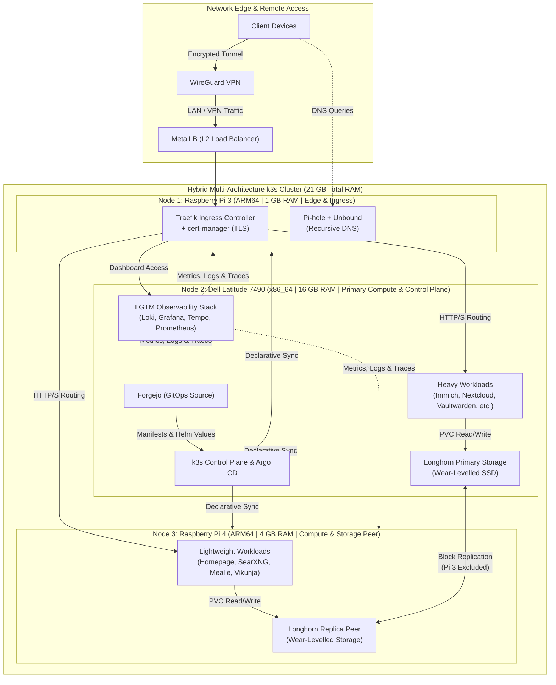

## Engineering Constraints & Solutions

* **Heterogeneous Node Scheduling:** Resolved architecture mismatches (ARM64 vs. AMD64) by enforcing multi-arch container image manifests and explicit node affinity and taint/toleration rules.
* **Storage Isolation:** Excluded SD-card-bound nodes (`pi-3`) from the Longhorn replica pool to increase storage bandwidth and mitigate storage degradation, offloading distributed storage strictly to wear-levelled media.
* **Resource Optimization:** Managed container density (14 active workloads) within a tightly constrained RAM ceiling using strict CPU/Memory request and limit allocations.

## Operational Resilience & Post-Mortems

This environment hosts several solutions that I use daily. Below are selected incident post-mortems documenting root-cause analyses and remediation strategies:

### 1. Cascading Resource Exhaustion (OOM)

* **Root Cause:** Application deployed without explicit container memory limits, leading to memory pressure on the node and Linux kernel OOM killer invocation.
* **Remediation:** Enforced resource quotas and defined default `requests` and `limits` across all deployment manifests in the GitOps repository.

### 2. Thermal Throttling & SD Card Disconnects on Pi 3
* **Impact:** The Pi 3 is the ingress node and also serves DNS for the home network, so when it degraded, DNS went down for the whole Wi-Fi network.

* **Root Cause:** Heat caused thermal throttling and transient SD card drops. Pods on the node failed their health checks and restarted while the node was still recovering.

* **Remediation:** Improved cooling and increased health check wait periods (initial delay and failure thresholds) on the workloads scheduled to that node, so they could tolerate a slow recovery instead of being restarted in a loop.

### 3. Recovery after Dual-Node Power Loss

* **Root Cause:** Simultaneous dual-node power failure caused container scheduling to fail and resulted in stuck volume attachments in Longhorn.

* **Remediation:** Verified volume integrity, gracefully cleared stale volume attachments and stuck claims, and restarted application deployments without persistent data loss.

## Screenshots & Telemetry

### Core Infrastructure & Observability
<details>
<summary><strong>Click to view application screenshots (4 images)</strong></summary>
<br>

**Grafana — Node Resource Utilization (21 GB Envelope)**


**Grafana — Namespace Workload Footprint**
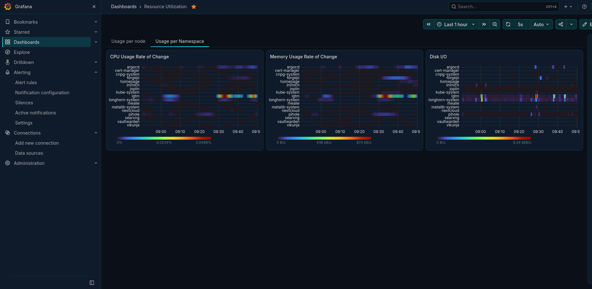

**Argo CD — Declarative GitOps Application Topology**
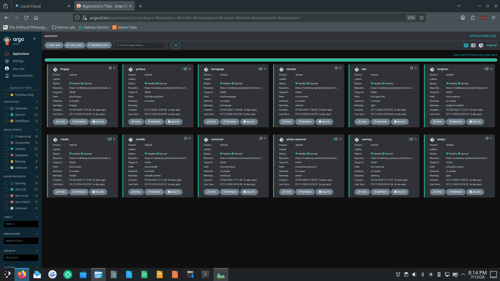

**Longhorn — Distributed Storage & Replica Scheduling**
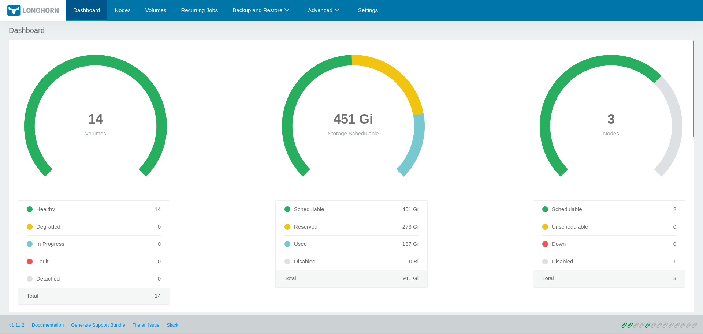

</details>

### Utility Services
<details>
<summary><strong>Click to view hosted application & edge service screenshots (8 services)</strong></summary>
<br>

**Homepage - Unified Cluster Dashboard**
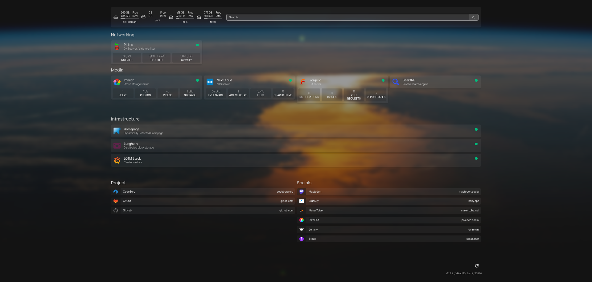

**Forgejo - Self-Hosted GitOps Source Repository**
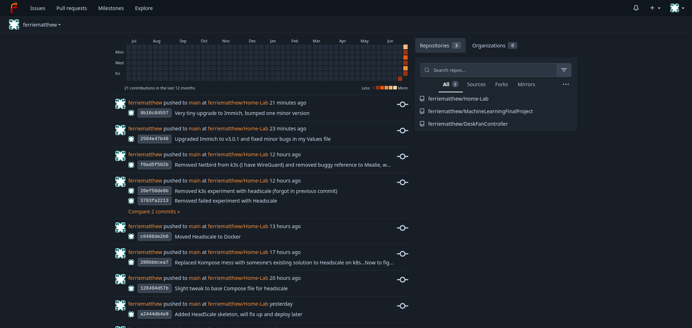

**Pi-hole + Unbound - Recursive DNS & Query Filtering**
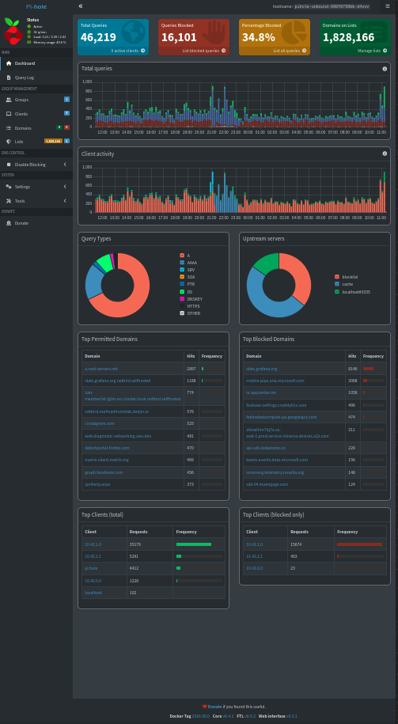

**Immich - Self-Hosted Media & ML Management**


**Nextcloud - Cloud Storage & Collaboration**
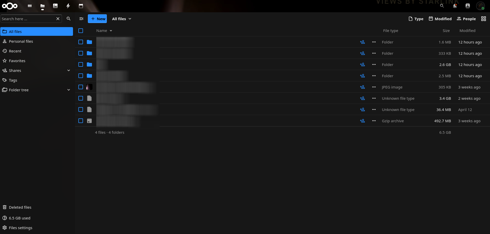

**Vaultwarden - Credential Management**
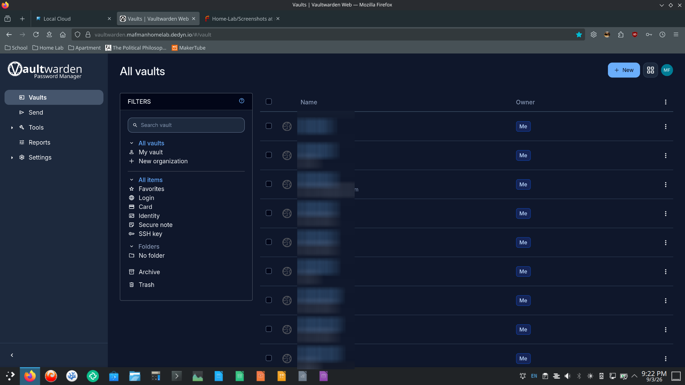

**SearXNG - Privacy-Respecting Metasearch**
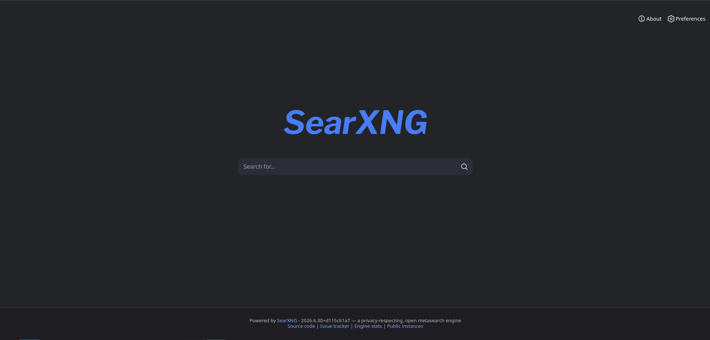

**Joplin - Encrypted Note Synchronization**
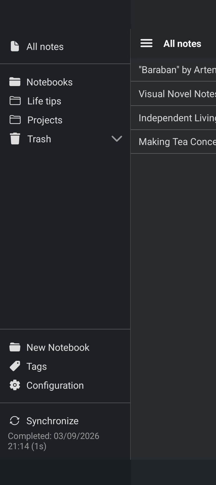

</details>
