# Multi-Architecture K3s Edge Cluster & GitOps Infrastructure

## Executive Overview
A declarative, multi-architecture Kubernetes (K3s) cluster managing ~24 stateful and stateless services across a hybrid node pool (ARM64 edge devices and x86_64 compute). Designed for high resource density within a 25GB RAM footprint, leveraging automated GitOps pipelines, distributed persistent storage, and secure network-edge access control.

## System Architecture & Technical Specifications

* **Orchestration:** K3s (Lightweight Kubernetes)
* **Compute Nodes:**
  * 1x Dell Latitude 7490 (x86_64 / AMD64) - Primary Compute / Control Plane & Storage
  * 2x Raspberry Pi 3/4 (ARM64) - Edge Compute & Supporting Services
* **Storage Engine:** Longhorn (Distributed block storage with persistent volume replication)
* **Continuous Delivery:** GitOps driven via Argo CD *(Migration to Flux scheduled)*
* **Ingress & Networking:** Traefik Ingress Controller terminated via edge-routed WireGuard VPN, load balanced by MetalLB
* **Resource Envelope:** 25 GB Total System Memory across node pools

## Engineering Constraints & Solutions

* **Heterogeneous Node Scheduling:** Resolved architecture mismatches (ARM64 vs. AMD64) by enforcing multi-arch container image manifests and explicit node affinity/toleration rules.
* **Storage Isolation:** Excluded SD-card-bound nodes from the Longhorn replica pool to prevent IOPS bottlenecks and storage degradation, offloading distributed storage strictly to wear-levelled media.
* **Resource Optimization:** Managed container density (~24 active workloads) within a tightly constrained 25GB RAM ceiling using strict CPU/Memory request and limit allocations.

## Operational Resilience & Post-Mortems

This environment is operated as a live production system. Below are selected incident post-mortems documenting root-cause analyses and remediation strategies:

### 1. Cascading Resource Exhaustion (OOM)
* **Root Cause:** Application deployed without explicit container memory limits, leading to memory pressure on the node and Linux kernel OOM killer invocation.
* **Remediation:** Enforced resource quotas and defined default `requests` and `limits` across all deployment manifests in the GitOps repository.

### 2. Thermal Throttling & Hardware Storage Disruption
* **Root Cause:** Environmental thermal throttling on compute hardware caused transient NVMe/SATA controller drops on the primary boot volume.
* **Remediation:** Adjusted physical thermal management, modified storage controller timeout thresholds, and implemented automated node health checks.

### 3. Distributed Consensus & Quorum Loss Recovery
* **Root Cause:** Simultaneous dual-node power failure caused etcd/dqlite quorum loss and stuck volume attachments in Longhorn.
* **Remediation:** Executed state-verification protocol, gracefully cleared stale volume attachments and stuck claims, and re-synchronized cluster consensus without persistent data loss.

## Screenshots
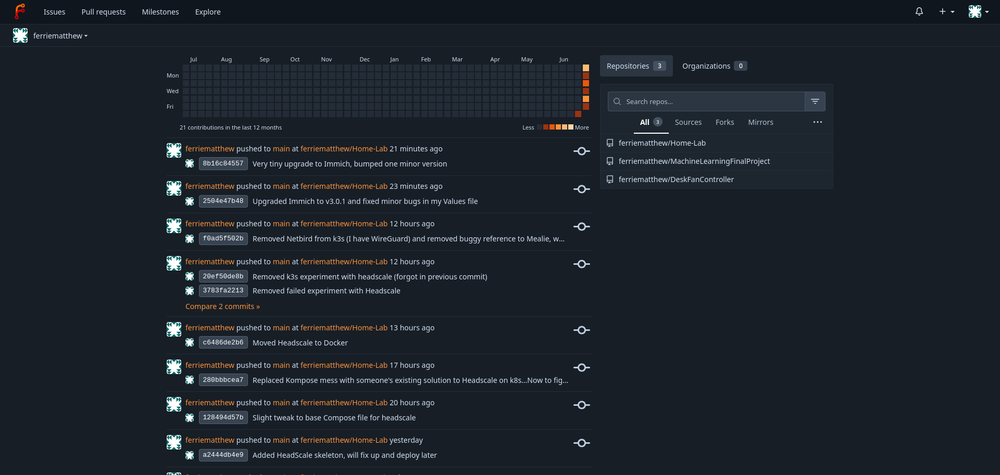
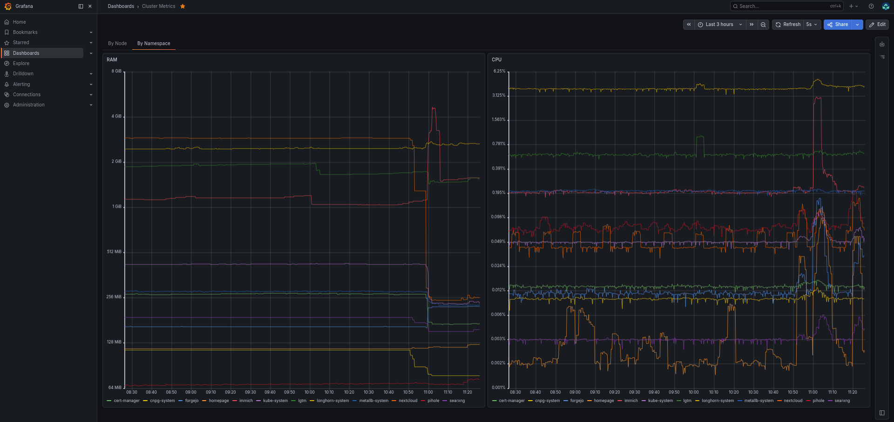
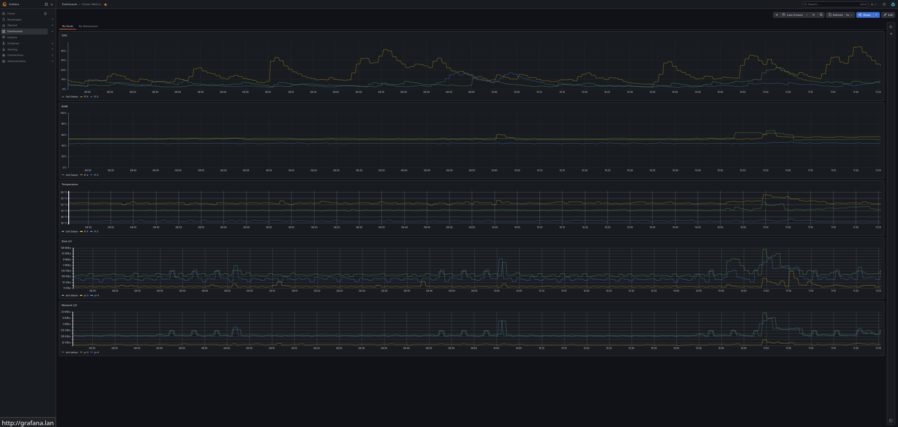
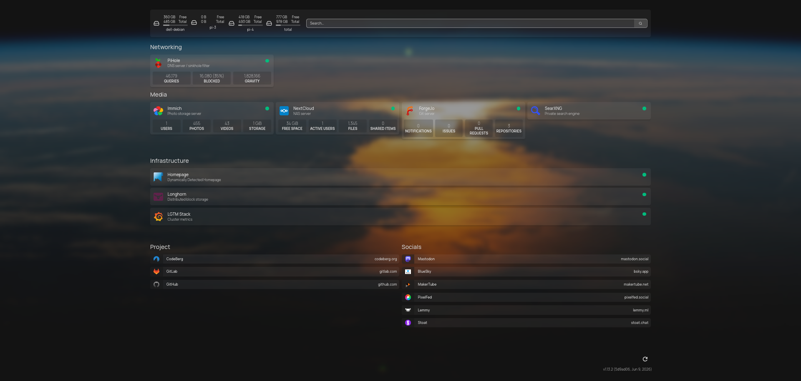
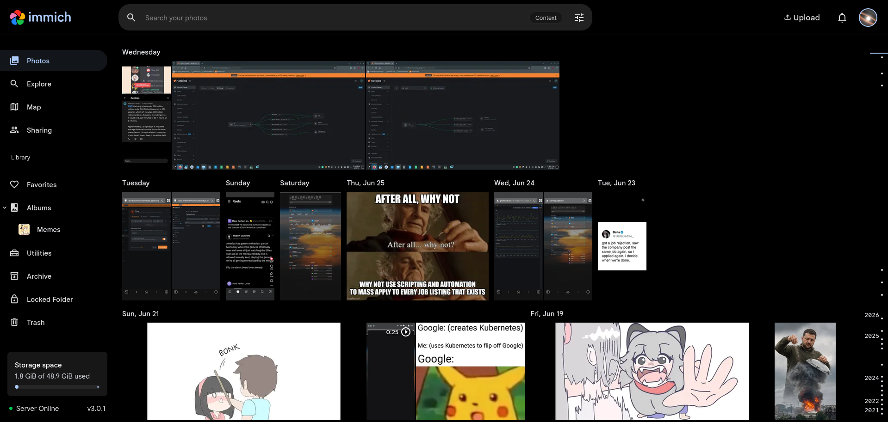
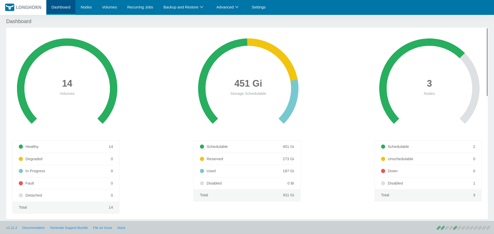
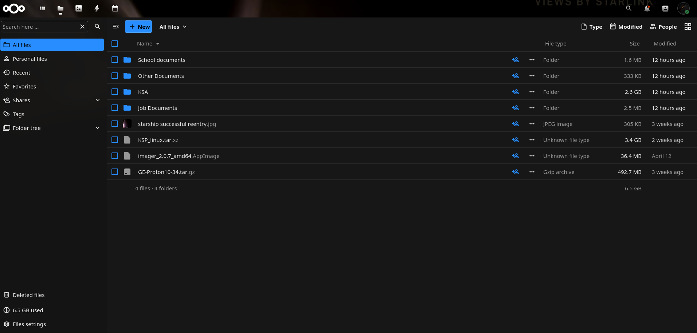
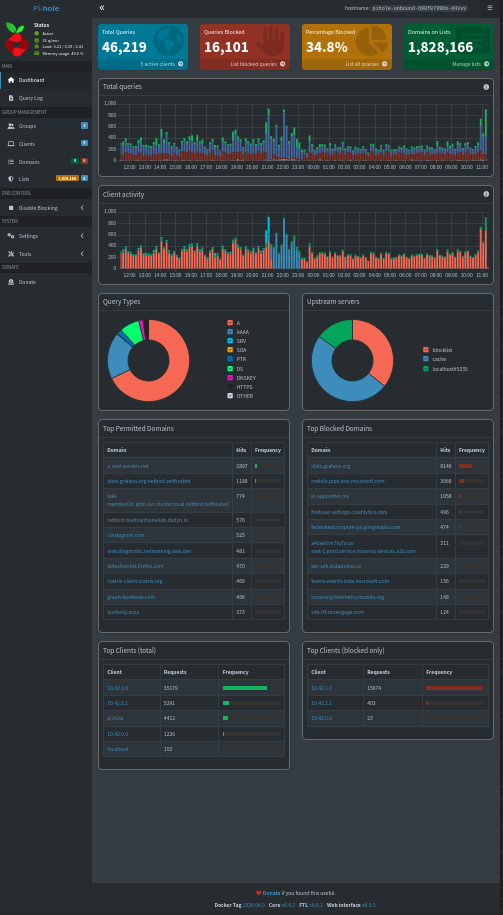
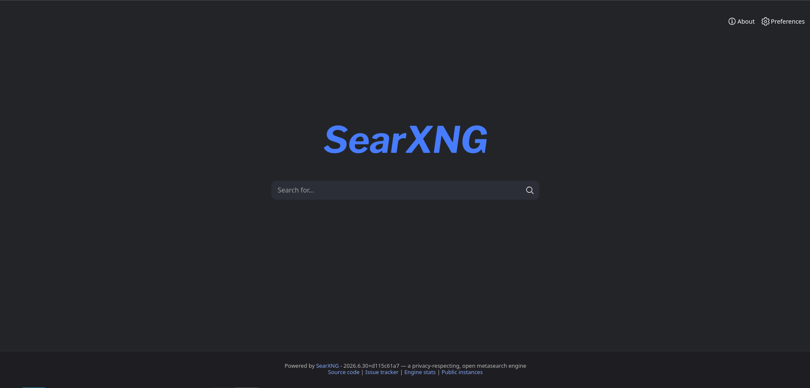
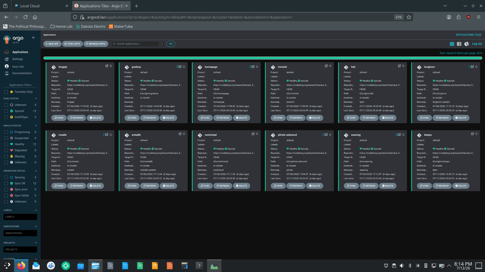
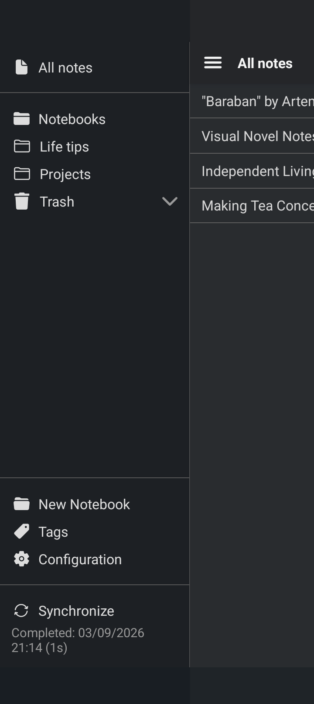
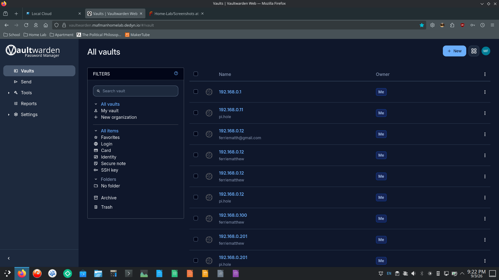